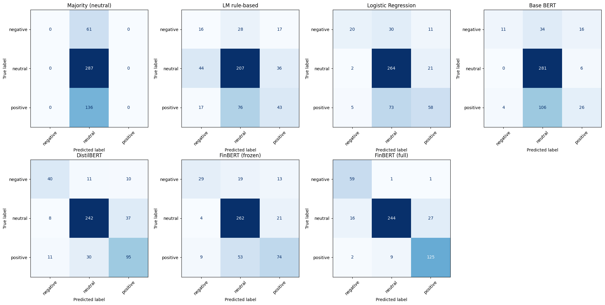

# Financial News Sentiment: Benchmark of 7 Models

Benchmark of seven sentiment classifiers on financial news headlines (Financial PhraseBank, 3 classes). The models range from a trivial baseline to transformer models. All of them are evaluated on the same held-out test set, with 95% bootstrap confidence intervals.

## Data

[Financial PhraseBank](https://huggingface.co/datasets/lmassaron/FinancialPhraseBank) (Malo et al., 2014): about 4,800 sentences from financial news, each labeled negative, neutral or positive. The notebook uses the predefined splits: 3,872 train, 484 validation, 484 test. The test set is imbalanced (59% neutral), so **macro-F1** is the main metric. The data is downloaded at runtime and is not stored in this repository.

## Models

1. **Majority class.** Always predicts "neutral" and sets the floor.
2. **Loughran–McDonald lexicon.** Rule-based scoring with the finance-specific sentiment dictionary (via `pysentiment2`).
3. **TF-IDF + logistic regression.** Unigrams and bigrams, 5,000 features.
4. **BERT-base, frozen encoder.** Only the classification head is trained.
5. **DistilBERT, frozen encoder.** Only the classification head is trained.
6. **FinBERT (`yiyanghkust/finbert-pretrain`), frozen encoder.** BERT pre-trained on financial text, with only the head trained.
7. **FinBERT (`ProsusAI/finbert`).** A fully fine-tuned sentiment model, evaluated as is, with labels remapped to match.

Models 4–6 are trained with early stopping on validation macro-F1 (patience 3, up to 20 epochs).

## Results

Test set, 484 sentences. Values are point estimates, with 95% bootstrap CIs (2,000 resamples) in brackets.

| Model | Accuracy | Macro-F1 |
|---|---|---|
| Majority class | 0.593 [0.548, 0.636] | 0.248 [0.236, 0.259] |
| LM lexicon | 0.550 [0.506, 0.593] | 0.432 [0.386, 0.477] |
| TF-IDF + logistic regression | 0.707 [0.665, 0.746] | 0.592 [0.532, 0.648] |
| BERT-base (frozen) | 0.657 [0.614, 0.698] | 0.455 [0.397, 0.511] |
| **DistilBERT (frozen)** | **0.779 [0.744, 0.814]** | **0.733 [0.688, 0.778]** |
| FinBERT-pretrain (frozen) | 0.754 [0.717, 0.791] | 0.671 [0.617, 0.723] |
| ProsusAI/finbert (reference)* | 0.884 [0.857, 0.911] | 0.874 [0.841, 0.905] |

\* `ProsusAI/finbert` was fine-tuned on the Financial PhraseBank itself, so its training data very likely overlaps this test split. It is reported as an upper reference, not as a held-out result.

**Takeaways**
- The finance-specific lexicon is worse than the majority baseline on accuracy. It beats the baseline on macro-F1 only because it predicts some negative and positive labels at all. A simple TF-IDF model is much stronger.
- With frozen encoders, the quality of the sentence representation decides the result. Frozen BERT-base barely beats the lexicon. DistilBERT is the best model trained here.
- Financial pre-trained representations (FinBERT-pretrain) did not beat DistilBERT. Their confidence intervals overlap, so this test set cannot separate the two.
- Bootstrap CIs on 484 test sentences are about ±0.04–0.06 for macro-F1. Differences smaller than that should not be read as real.



## Running it

The notebook was run on Google Colab with a T4 GPU. To run it there, open Colab, choose File → Open notebook → GitHub, and paste this repository's URL. The first code cell installs the two packages that Colab lacks. To run it locally instead:

```bash
pip install -r requirements.txt
jupyter notebook financial_sentiment_benchmark.ipynb
```

No API keys are needed, because all models and the dataset are public on the Hugging Face Hub. Trained models are saved to `models/`, which is git-ignored.

## References

- Malo, P., Sinha, A., Korhonen, P., Wallenius, J., & Takala, P. (2014). Good debt or bad debt: Detecting semantic orientations in economic texts. *JASIST*, 65(4).
- Loughran, T., & McDonald, B. (2011). When is a liability not a liability? Textual analysis, dictionaries, and 10-Ks. *Journal of Finance*, 66(1).
- Araci, D. (2019). FinBERT: Financial sentiment analysis with pre-trained language models. arXiv:1908.10063.

## License

Code: MIT. Financial PhraseBank is distributed by its authors under CC BY-NC-SA 3.0.
